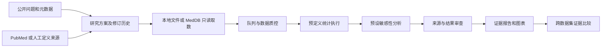

# 架构与唯一运行源码

## 新增研究任务层

v2 全流程实现：`study_contract` 声明研究设计与数据集边界，`planning/agent` 管理公开元数据规划
与有预算的执行，`data` 复用 MedDB 取数，`quality` 做队列和质量验证，`statistics` 执行预定义方法，
`literature` 管理文献/定义来源，`workflow` 管理可恢复阶段与跨研究比较，`reporting` 输出证据审查、
报告和图表。`demo` 是合成端到端验收入口。详细边界见 [FULL_RESEARCH_WORKFLOW.md](FULL_RESEARCH_WORKFLOW.md)。

`src/medresearch` 在唯一 MedDB 执行核心之上提供 ResearchSpec、无工具模型生成、
强制只读工具适配、可恢复执行与产物追踪。`context/knowledge` 存放提炼后的通用医学规则。
首个流程为 MIMIC-IV 描述性聚合研究，CLINSQL validation 通过独立适配器评分；
不再借用 `evals/legacy` 作为日常运行入口。完整边界与命令见 [RESEARCH_AGENT.md](RESEARCH_AGENT.md)。

以下保留历史实现的职责映射：

保留 Pi 思想的五个责任边界，不冒充特定 SDK 的原生实现：

| 责任 | 本仓库位置 | 当前状态 |
| --- | --- | --- |
| Agent 循环/模型调用 | evals/legacy/run_clinsql_model_generation.py | 历史 Codex CLI 实现，尚需配置化 |
| 只读工具 | src/meddb | 唯一 CLI 运行源码；根目录可安装 |
| 上下文 | context/schemas、配置、领域参考 | Gold 不进入生成上下文 |
| Skill 扩展 | .agents/skills/meddb-repository | 仓库维护入口；非原生 Pi 插件 |
| 评测/状态/调度 | evals/legacy | 保留原实现及其复现边界 |

不在多个 plugin、Skill 和脚本目录复制 CLI 运行源码。scripts/run_meddb.py 只做路径引导。旧目录映射见 MIGRATION.md。
